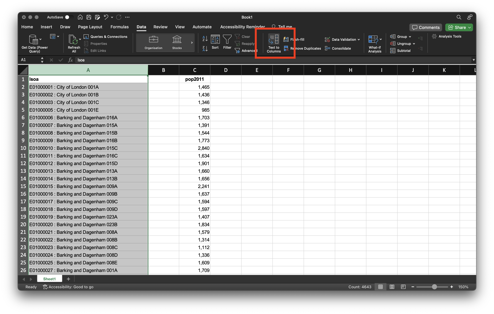
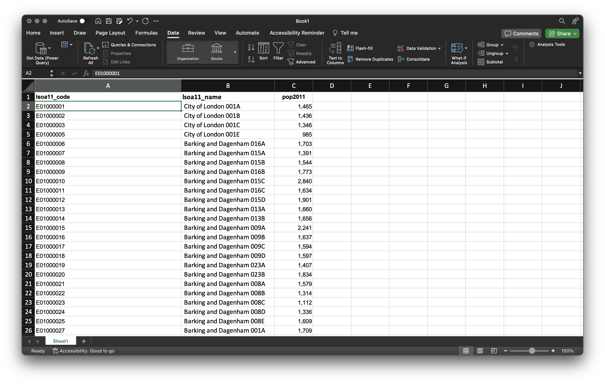
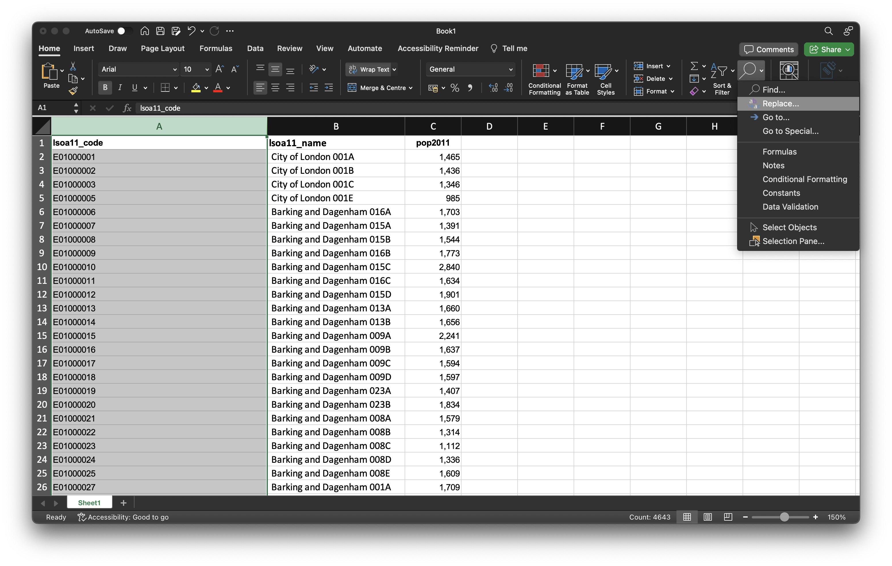
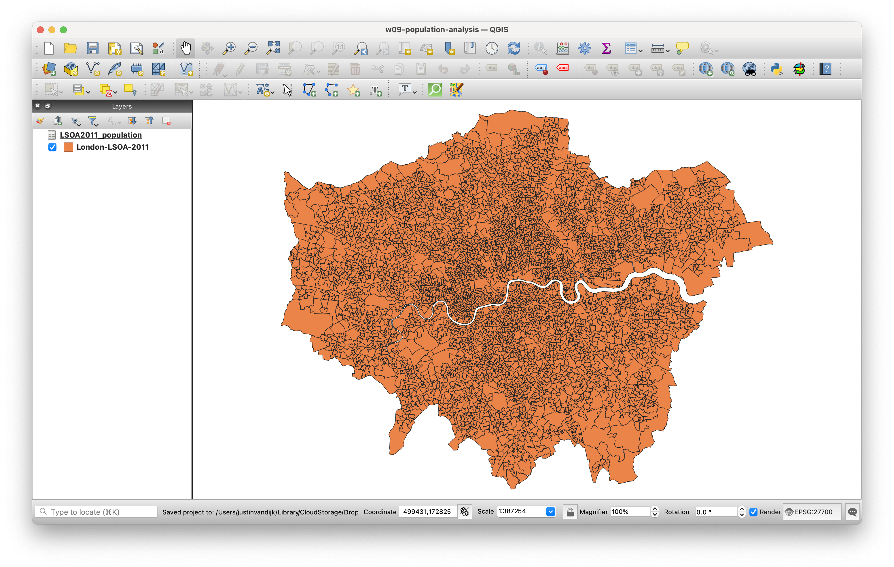
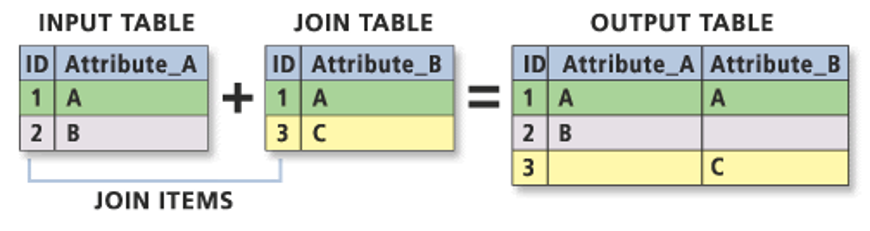
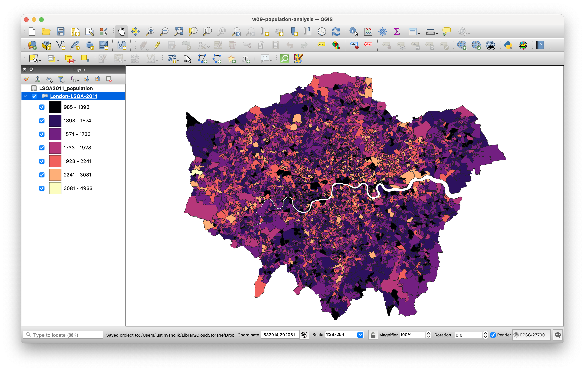

# Spatial Analysis I
This week introduces how spatial data is represented in GIScience and GIS software, where to find spatial data, and how to link a table to spatial data with an attribute join. In the practical, you will prepare Census population counts, join them to the boundaries of small areas in London, and map the result using [QGIS](https://qgis.org/). The result is a *choropleth map*, a thematic map that shades areas by a value.

## Lecture slides
You can download the slides of this week's lecture here: [[Link]]().

## Reading list
#### Essential readings {.unnumbered}
- Longley, P. *et al.* 2015. Geographic Information Science & Systems, **Chapter 2**: *The Nature of Geographic Data*, pp. 33-54. [[Link]](https://ucl.rl.talis.com/link?url=https%3A%2F%2Fapp.knovel.com%2Fhotlink%2Ftoc%2Fid%3AkpGISSE001%2Fgeographic-information-science%3Fkpromoter%3Dmarc&sig=e437927b963cc591dcb65491eccdd3869cc31aef80e1443cb2ba12d8f3bb031a)
- Longley, P. *et al.* 2015. Geographic Information Science & Systems, **Chapter 3**: *Representing Geography*, pp. 55-76. [[Link]](https://ucl.rl.talis.com/link?url=https%3A%2F%2Fapp.knovel.com%2Fhotlink%2Ftoc%2Fid%3AkpGISSE001%2Fgeographic-information-science%3Fkpromoter%3Dmarc&sig=e437927b963cc591dcb65491eccdd3869cc31aef80e1443cb2ba12d8f3bb031a)

#### Suggested readings {.unnumbered}
- Yuan, M. 2001. Representing complex geographic phenomena in GIS. *Cartography and Geographic Information Science* 28(2): 83-96. [[Link]](https://doi.org/10.1559/152304001782173718)

## Installation of QGIS
QGIS is an open-source graphic user interface GIS with many community developed add-on packages that provide additional functionality to the software. You can download and install QGIS on your personal machine by going to the QGIS website: [[Link]](https://qgis.org/en/site/forusers/download.html).

::: {.callout-important}
QGIS is available through [Desktop@UCL Anywhere](https://www.ucl.ac.uk/isd/services/computers/remote-access/desktopucl-anywhere) and on UCL computers across campus. Instead of installing the software, you may want to consider using this version. Note that Desktop@UCL Anywhere currently provides QGIS 3.34, which is slightly older than the version recommended below but can be used for everything in this workbook.
:::

::: {.callout-note}
If you want to install QGIS on your personal computer, we recommend installing the **Long Term Release** (*QGIS 3.44 LTR*), as this is the most stable version. A newer QGIS 4 release is also available on the download page, but its menus and tools may differ from the instructions in this workbook, so please choose the LTR. For Windows users, please note that the QGIS installation process may take some time, so be patient during the setup.
:::

After installation, launch QGIS to confirm that the installation was successful.

::: {.callout-note}
## If your screen looks different
QGIS, Nomis and Excel change their layout from version to version. This chapter therefore describes *what* to click by its label (e.g. [Add Layer]{.ui}). If a label has moved or been renamed, look for the closest equivalent, and ask in class if you cannot find it.
:::

## Population in London
In this tutorial, we will map the population distribution in London using Census estimates from 2011 and 2021. When working with quantitative data, much of the effort goes into data preparation rather than analysis. It is often said that 80% of the time is spent on tasks like finding, retrieving, managing, and processing data. This is because the data you need is rarely in the format required for analysis. Before we can create our maps, we therefore have to go through several data preparation and cleaning steps.

We will work with Lower layer Super Output Areas (LSOAs), small census areas with roughly 1,000 to 3,000 residents that we also used in [week 1](01-recap.html). To get started, download a copy of the 2011 and 2021 London LSOA spatial boundaries via the links provided below. Save these files in your project folder under `data`.

| File                                        | Type   | Link |
| :------                                     | :------| :------ |
| London LSOA 2011 Spatial Boundaries         | `GeoPackage` | [Download](https://github.com/jtvandijk/GEOG0018/raw/master/data/London-LSOA-2011.gpkg) |
| London LSOA 2021 Spatial Boundaries         | `GeoPackage` | [Download](https://github.com/jtvandijk/GEOG0018/raw/master/data/London-LSOA-2021.gpkg) |

::: {.callout-note}
Administrative geographies, such as LSOAs, are typically updated as populations change, meaning their boundaries are subject to periodic or occasional adjustments. For this reason, we must use the 2011 LSOA boundaries to map the 2011 Census data and the 2021 LSOA boundaries for the 2021 Census data.
:::

::: {.callout-note}
For the spatial boundaries of the London LSOAs, you may have noticed that, instead of providing a collection of files known as a `shapefile`, we have supplied a `GeoPackage`. While `shapefiles` remain in use, `GeoPackage` is a more modern and portable file format. Have a look at this article on *towardsdatascience.com* for an excellent explanation on why one should use `GeoPackage` files over `shapefiles`, where possible: [[Link]](https://towardsdatascience.com/why-you-need-to-use-geopackage-files-instead-of-shapefile-or-geojson-7cb24fe56416)
:::

For our population data, we will use the 2011 and 2021 Census population counts that are made available by the Office for National Statistics through their [Nomis](https://www.nomisweb.co.uk/) portal.

To get the 2011 Census population counts, you should:

1. Navigate to the *Nomis* portal: [[Link]](https://www.nomisweb.co.uk/)
2. Click on [Query data]{.ui} in the [Data Downloads]{.ui} panel.
3. Click on [Census 2011]{.ui} → [Key Statistics]{.ui}.
4. Click on [KS101EW - Usual resident population]{.ui}.
5. Select [Geography]{.ui} and set [2011 super output areas - lower layer]{.ui} to [All]{.ui}.
6. Click on [Download data]{.ui} at the left hand side of the screen.
7. Once the data is ready for download, save it to your computer in your `data` folder as `LSOA2011-population.xlsx`.

To get the 2021 Census population counts, you should:

1. Navigate to the *Nomis* portal: [[Link]](https://www.nomisweb.co.uk/)
2. Click on [Query data]{.ui} in the [Data Downloads]{.ui} panel.
3. Click on [Census 2021]{.ui} → [Topic Summaries]{.ui}.
4. Click on [TS007A - Age by five-year age bands]{.ui}.
5. Select [Geography]{.ui} and set [2021 super output areas - lower layer]{.ui} to [All]{.ui}.
6. Click on [Download data]{.ui} at the left hand side of the screen.
7. Once the data is ready for download, save it to your computer in your `data` folder as `LSOA2021-population.xlsx`.

### Data preparation
When opening the LSOA spreadsheets in Excel, you will notice additional rows of information at the top. This extra data can cause issues in QGIS, so we need to clean the dataset. To avoid errors later on, we will also save the cleaned data in `csv` format.

::: {.callout-tip}
The preparation of the 2011 data is repetitive, because the 2011 file is not grouped by borough. If you are short of time, you can download a prepared version of the 2011 file ([Download](https://github.com/jtvandijk/GEOG0018/blob/master/data/LSOA2011-population.csv)) and continue with the preparation of the 2021 data.
:::

#### London population in 2011 {.unnumbered}
Open the `LSOA2011-population.xlsx` file in Excel. We have two main columns: one with identifying information that distinguishes each area from one another and one with population counts. In addition, there are some less informative rows at the top of the spreadsheet. To prepare the data we need to take several steps.

1. Open a new, empty Excel spreadsheet.
2. From the `LSOA2011-population.xlsx` spreadsheet, select and delete row **1 to 8**: highlight the rows, then click on [Edit]{.ui} in the menu bar and click on [Delete]{.ui}.

::: {.callout-warning}
Note that the [Edit]{.ui} menu bar option might be named differently, depending on your version of Excel and/or your operating system.
:::

3. Rename the columns in your spreadsheet to `lsoa` and `pop2011`, respectively.
4. Cut all the data from the `pop2011` column that is stored in column **B** and paste these into column **C**. You now should have a column *without* any data sat between the `lsoa` and `pop2011` columns.
5. Highlight the entire `lsoa` column and in the [Data]{.ui} menu click on the [Text to Columns]{.ui} menu button.

```{r}
#| label: fig-text-to-columns
#| echo: False
#| cache: True
#| fig-cap: 'Highlight the `lsoa` columns and find the [Text to Columns]{.ui} menu option. Note that column **B** does not contain any data.'

```

::: {.callout-warning}
Note that the [Text to Columns]{.ui} function might be elsewhere in the menu depending on your version of Excel and/or your operating system.
:::

6. In the [Text to Columns]{.ui} menu, select the [Delimited]{.ui} radio button and click [Next]{.ui}.
7. Uncheck the checkbox for [Tab]{.ui} and put `:` (colon) into the [Other]{.ui} box. Click [Finish]{.ui}.
8. Change the name of the `lsoa` column to `lsoa11_code` and change the name of the now populated column **B** to `lsoa11_name`.

```{r}
#| label: fig-almost-there
#| echo: False
#| cache: True
#| fig-cap: 'Your spreadsheet should now look something like this.'

```

9. Select all three columns, click on [Data]{.ui} in the menu bar and select [Sort]{.ui}. In the window that opens, select `lsoa11_name` as column to sort your data on. Click [OK]{.ui}.
10. Now we need to identify the LSOAs pertaining to London. Unfortunately, we can only do this manually by searching for the name of each of the London Boroughs and subsequently cutting ([Edit]{.ui} → [Cut]{.ui}) the associated rows of data from the spreadsheet and pasting these into the second, empty spreadsheet that you created in *Step 1*.
11. Go to [Edit]{.ui} → [Find]{.ui} → [Find]{.ui}. Type in **City of London**. Cut ([Edit]{.ui} → [Cut]{.ui}) the six rows of data (*City of London 001A*, *City of London 001B*, etc.) and paste these into the second, empty spreadsheet. Make sure to give your columns appropriate names.
12. Repeat this process to find all London LSOAs by searching for the names of all remaining **32** London Boroughs (see @tbl-boroughs for a list).

::: {.callout-tip}
You can make this process a bit less tedious by using keyboard shortcuts. On MacOS you can use: `cmd + f` to open up the find menu, `cmd + x` to cut data, and `cmd + v` to paste data. On Windows you can use: `ctrl + f` to open up the find menu, `ctrl + x` to cut data, and `ctrl + v` to paste data.
:::

::: {.callout-warning}
Searching for *Brent* also finds the LSOAs of *Brentwood*, a local authority in Essex. Only cut the rows named *Brent 001A*, *Brent 001B*, and so on (173 LSOAs in total).
:::

::: {.callout-warning}
Once you are done cutting and pasting, you should have **4,836** rows of data in your second spreadsheet; this count includes your column names.
:::

| London Boroughs                               |
| :----                   | :----               |
| Westminster             | Sutton              |
| Kensington and Chelsea  | Croydon             |
| Hammersmith and Fulham  | Bromley             |
| Wandsworth              | Lewisham            |
| Lambeth                 | Greenwich           |
| Southwark               | Bexley              |
| Tower Hamlets           | Havering            |
| Hackney                 | Barking and Dagenham|
| Islington               | Redbridge           |
| Camden                  | Newham              |
| Brent                   | Waltham Forest      |
| Ealing                  | Haringey            |
| Hounslow                | Enfield             |
| Richmond upon Thames    | Barnet              |
| Kingston upon Thames    | Harrow              |
| Merton                  | Hillingdon          |

: The names of all London Boroughs. {#tbl-boroughs}

13. One potential issue when linking the population data to the spatial data is the presence of [trailing spaces](https://stackoverflow.com/questions/22273233/what-is-meant-by-trailing-space-and-whats-the-difference-between-it-and-a-blank) in the `lsoa11_code` column. These spaces are not immediately noticeable, as they appear at the end of the LSOA codes without any visible characters following them. Although this may seem minor, it can cause problems when using the data. To fix this, highlight the entire `lsoa11_code` column in your new spreadsheet, go to the [Home]{.ui} menu, and select [Replace]{.ui} under the [Find & Select]{.ui} menu.

```{r}
#| label: fig-find-replace
#| echo: False
#| cache: True
#| fig-cap: 'Accessing the [Replace]{.ui} option.'

```

14. In the [Find what]{.ui} box put in a singular `whitespace`, using the *spacebar* on your keyboard, keep the [Replace with]{.ui} box empty, and click on [Replace all]{.ui}. You should get a message that **4,835** replacements have been made.

Before saving your data, one final bit of formatting is needed for the population field. Currently, commas are used to separate the thousands in the values. If we leave these commas, QGIS will interpret them as decimal points, resulting in incorrect population figures.

15. To format the `pop2011` column, highlight the entire column and *right-click* on the `C` cell. Click on [Format Cells]{.ui} and set the cells to [Number]{.ui} with **0** decimal places. You should see that the commas are now removed from your population values.
16. Save your spreadsheet as a `csv` file into your `data` folder as `LSOA2011-population.csv`.

::: {.callout-tip}
After saving the file, Excel may prompt a warning about possible data loss. You can safely ignore this message, as it typically relates to lost markup information (e.g. fonts, colours, bold items) or Excel formulas (e.g. means, medians). If prompted, choose to save as `CSV UTF-8 (Comma-delimited) (.csv)`.
:::

::: {.callout-warning}
Be aware that depending on your operating system's language settings (e.g. Windows, macOS, Linux), `csv` files might use different characters instead of commas. While this may seem trivial, it can lead to issues when importing data into another program. Therefore, it is wise to check your `csv` file in a plain text editor (e.g. [TextEdit]{.ui} on macOS or [Notepad]{.ui} on Windows). If you see semicolons (`;`) instead of commas (`,`), you can quickly fix this by finding and replacing every semicolon with a comma, just as we did with the `whitespace` characters in Excel.
:::

#### London population in 2021 {.unnumbered}
Now the 2011 data is prepared, we can move on to the 2021 data. Open the `LSOA2021-population.xlsx` in Excel. You will notice that the file is formatted largely the same as the `LSOA2011-population.xlsx` file. However, this time the data for all Local Authority Districts are grouped together, with all data also grouped by region. This arrangement simplifies our task, as we can easily cut the data for each of the 32 Boroughs and the *City of London* in one go.

1. Open a new Excel spreadsheet.
2. From the `LSOA2021-population.xlsx` spreadsheet, cut ([Edit]{.ui} → [Cut]{.ui}) all cells from columns **A to B** and rows **19,790 to 24,783** and paste these into this new spreadsheet.
3. Take the remaining steps to prepare the 2021 population data: split the `lsoa` column, remove the trailing `whitespace` characters from the LSOA code column, and remove the commas in the population count column.
4. Save the file as `csv` into your `data` folder as `LSOA2021-population.csv` with the following column names: `lsoa21_code`, `lsoa21_name`, and `pop2021`.

::: {.callout-warning}
Again make sure you did not miss any LSOAs. You should end up with **4,995** rows of data in this second spreadsheet.
:::

### Data merging
We will now use QGIS to map our prepared population data. To achieve this, we first need to join our table data to our spatial datasets.

1. Start **QGIS**.
2. Click on [Project]{.ui} → [New]{.ui}. Save your project as `w09-population-analysis`. Remember to save your work throughout the practical.
3. Before we add our data, we will first set the Coordinate Reference System (CRS) of our Project. Click on [Project]{.ui} → [Properties]{.ui} → [CRS]{.ui}. In the Filter box, type **British National Grid**. Select [OSGB36 / British National Grid - EPSG:27700]{.ui} (older versions of QGIS call this *OSGB 1936 / British National Grid*) and click [Apply]{.ui}. Click [OK]{.ui}.

::: {.callout-note}
A CRS is a framework that defines how spatial data is represented in relation to the Earth's surface. It includes both a coordinate system (which specifies how points in space are represented using numbers) and a set of parameters that define the relationship between those coordinates and actual locations on the Earth. The LSOA boundary files we use are stored in the British National Grid, so we give our project the same CRS.
:::

Now the project is set up, we can start by loading our 2011 spatial layer.

4. Click on [Layer]{.ui} → [Add Layer]{.ui} → [Add Vector Layer]{.ui}.
5. With [File]{.ui} as your source type, click on the small three dots button and navigate to your `data` folder.
6. Highlight the `London-LSOA-2011.gpkg` file and click [Open]{.ui}. Then click [Add]{.ui}. You may need to close the box after adding the layer.

Next, we will load our 2011 population `csv`.

7. Click on [Layer]{.ui} → [Add Layer]{.ui} → [Add Delimited Text Layer]{.ui}.
8. Click on the three dots button again and navigate to the `LSOA2011-population.csv` file in your `data` folder. Your file format should be set to `csv`. You should further have the following boxes ticked under the [Record and Field options]{.ui} menu: `Decimal separator is comma`, `First record has field names`, `Detect field types` and `Discard empty fields`.
9. Set the Geometry to *No geometry (attribute only table)* under the [Geometry Definition]{.ui} menu. Then click [Add]{.ui} and [Close]{.ui}. You should now see a table added to your *Layers* pane.

```{r}
#| label: fig-lsoa-london
#| echo: False
#| cache: True
#| fig-cap: 'The 2011 London LSOAs.'

```

We can now join this table data to our spatial data using an *attribute join*.

::: {.callout-note}
An *attribute join* allows you to link two datasets together based on a common attribute that facilitates the matching of rows. To perform an attribute join, you need a single unique identifying field for your records in both datasets. This can be a code, a name, or any other string of information. For the join to work, it is essential that the ID field is consistent across both datasets, meaning there should be no typos or spelling mistakes. In QGIS, the identifier in the table is called the [Join field]{.ui} and the identifier in the spatial layer the [Target field]{.ui}.

```{r}
#| label: fig-join-those-attributes
#| echo: False
#| cache: True
#| fig-cap: 'Attribute Joins.'

```
:::

Because both our datasets contain both LSOA names and LSOA codes, we will use the LSOA codes as basis for our join. Unlike names, codes reduce the likelihood of errors and mismatches since they are not dependent on spelling.

10. Open up the [Attribute Tables]{.ui} of each layer to confirm the column names that we can use for the join.
11. *Right-click* on your `London-LSOA-2011` spatial layer, click on [Properties]{.ui} and then click on the [Joins]{.ui} tab.
    - Click on the [+]{.ui} button. Make sure the [Join Layer]{.ui} is set to `LSOA2011-population`.
    - Set the [Join field]{.ui} to `lsoa11_code`.
    - Set the [Target field]{.ui} to `lsoa11cd`.
    - Click the [Joined Fields]{.ui} box and click to only select the `pop2011` field.
    - Click on the [Custom Field Name Prefix]{.ui} and **remove** the pre-entered text to leave it blank.
    - Click on [OK]{.ui}.
    - Click on [Apply]{.ui} in the main Join tab and then click [OK]{.ui} to return to the main QGIS window.

We can now check to see if our join has worked by opening up the [Attribute Table]{.ui} of our `London-LSOA-2011` spatial layer. We should see that the spatial layer has a new `pop2011` field attached to it.

::: {.callout-tip}
QGIS keeps every polygon of the spatial layer when it joins a table. If a code does not match, the polygon stays on the map but its `pop2011` value is empty (`NULL`). Click on the header of the `pop2011` column to sort it: all **4,835** LSOAs should have a population count. Empty values point to codes that do not match, for example because of a stray space or because the table and the boundaries come from different years.
:::

### Data mapping
We can now finally map the 2011 population distribution of London.

::: {.callout-note .exercise icon=false}
## Predict first
Before you style the layer, do you expect to see a clear pattern from the centre of London to the edges, or a patchwork of high and low values? Why might that be, given that LSOAs are designed to have similar numbers of residents?
:::

12. *Right-click* on the `London-LSOA-2011` layer and click on [Properties]{.ui} → [Symbology]{.ui}.
    - In the dropdown menu at the top of the window, select [Graduated]{.ui} as symbology.
    - Under [Value]{.ui} choose `pop2011` as your column.
    - We can then change the colour ramp to suit our aesthetic preferences. In the [Color ramp]{.ui} dropdown menu select *Magma*.
    - The final step is to classify our data, which involves deciding how to group the values in our dataset to create a graduated representation. Today we will use the [Natural Breaks (Jenks)]{.ui} option; next week covers the different classification options. Open the drop-down menu next to [Mode]{.ui}, select [Natural Breaks (Jenks)]{.ui}, change it to **7** classes and then click [Classify]{.ui}.
    - Finally click [Apply]{.ui} to style your dataset.

You should now be looking at something like this:

```{r}
#| label: fig-lsoa-pop-2011
#| echo: False
#| cache: True
#| fig-cap: 'The population distribution of London in 2011.'

```

::: {.callout-note .exercise icon=false}
## Try it yourself
Go back to the [Symbology]{.ui} tab and change the [Mode]{.ui} to [Equal Count (Quantile)]{.ui}, or change the number of classes. Predict how the map and the class ranges will change before you click [Apply]{.ui}. Which version tells you more about where the high values are?
:::

::: {.callout-warning}
While the map above is acceptable for today, it is technically incorrect because it displays absolute numbers on a choropleth. You should never do this unless the spatial units are identical in size, as larger areas will draw disproportionate attention and skew the visualisation. Next week, we return to this problem when we calculate rates.
:::

To export your map to an image, click on [Project]{.ui} → [Import/Export]{.ui} → [Export Map to Image]{.ui}.

## Homework task
This concludes this week's tutorial. Now complete the following homework tasks:

1. Load the `London-LSOA-2021.gpkg` into QGIS.
2. Load the `LSOA2021-population.csv` into QGIS.
3. Join the two datasets together using an **Attribute Join** and check that no LSOA is left without a population count.
4. Style your data appropriately.
5. Export your map as an image.

::: {.callout-note .exercise icon=false}
## Assignment appendix
Paste the exported map into the appendix of your assignment and include a few sentences interpreting the results. The exported map has no legend, so also state what the colours mean, using the class ranges shown in the [Symbology]{.ui} tab. Next week, we add a legend, title, scale bar and north arrow using the print layout.
:::

## Before you leave
This week we spent a lot of time preparing and cleaning our datasets, followed by a simple visualisation of the population in London in 2011 and 2021. Next week, we will move forward with working in QGIS and conduct some point data aggregation. For today, however, [we are done](https://www.youtube.com/watch?v=Wmc8bQoL-J0)!
